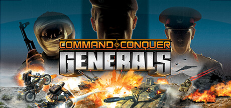

**Command & Conquer: Generals is the modern warfare RTS featuring USA, China, and the GLA terrorist organization each with distinct units and abilities. Features Generals upgrades and sub-general specializations that dramatically change playstyle.**

---

## 📖 About

Command & Conquer: Generals is the modern warfare RTS featuring USA, China, and the GLA terrorist organization each with distinct units and abilities. Features Generals upgrades and sub-general specializations that dramatically change playstyle.

## ⚠️ Problems Without Trainer

| Problem | Status |
|---------|--------|
| **GLA Tunnel Network** — GLA's underground unit repositioning is difficult to counter for new players | ✅ Solved |
| **Particle Cannon Timing** — USA Superweapon requires anticipating exactly where to deploy | ✅ Solved |
| **Air Unit Vulnerability** — High investment in air units is countered by specific AA units | ✅ Solved |
| **Skirmish AI Aggression** — Hard AI rushes very early, punishing slow opening builds | ✅ Solved |

## ✅ Solution

The **Command & Conquer: Generals Trainer** solves all these issues by giving you complete control over the game.

## 🎯 Full Feature List

- Unlimited Resources
- God Mode / Invincibility
- Instant Skill Cooldown
- One-Hit Kill
- Freeze Game Timer
- Unlock All Items & Achievements
- Custom Speed Multiplier
- Save State Anywhere

## 🚀 Quick Start

1. **Disable Windows Defender** temporarily (trainer may trigger false positive)
2. Download the trainer from the button above
3. Launch Command & Conquer: Generals
4. Run the trainer as Administrator
5. Activate desired cheats with hotkeys

## 💎 Free vs Paid

| Feature | Free | Pro |
|---------|------|-----|
| Basic God Mode | ✅ | ✅ |
| Unlimited Resources | ✅ | ✅ |
| All Advanced Cheats | ❌ | ✅ |
| Auto-Updates | ❌ | ✅ |
| Priority Support | ❌ | ✅ |

## 💻 Requirements

- Windows 10/11 (64-bit)
- Command & Conquer: Generals (any version)
- .NET Framework 4.8+
- DirectX 11+

## 🍎 macOS

macOS users can use our alternative tool:

## ⚖️ Legal

This trainer is for educational and single-player use only. Use responsibly.

---

